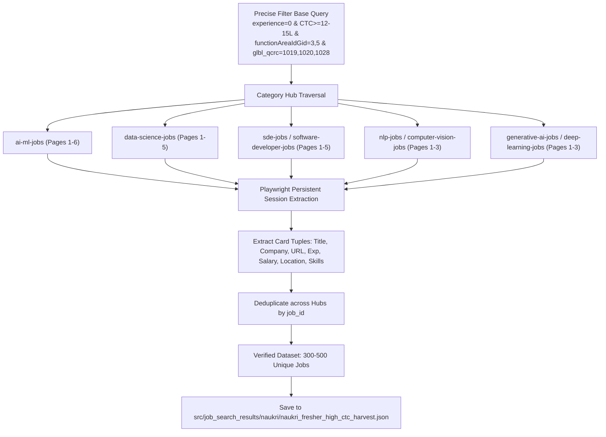

# Naukri High-CTC Fresher Job Extraction Plan & Playbook

This document captures the extraction architecture, verified filter URL parameters, DOM scrapers, deduplication strategy, and anti-bot guidelines for harvesting high-CTC (≥12–15 LPA) Fresher (0–2 YoE) AI/ML, Data Science, and Software Development job postings from Naukri.com.

---

## 1. Objective & Extraction Parameters

- **Target Domain**: Naukri.com (`www.naukri.com`)
- **Target Audience**: Freshers and early-career engineers (0–2 YoE) in:
  1. AI / ML Engineering (`glbl_qcrc=1019`: Data Science & Machine Learning)
  2. Data Science & Analytics (`glbl_qcrc=1020`: Data Science & Analytics)
  3. Software Development (`glbl_qcrc=1028`: Software Development)
- **Functional Areas / Departments**:
  - `functionAreaIdGid=3`: Data Science & Analytics
  - `functionAreaIdGid=5`: Engineering - Software & QA
- **Compensation Filters (CTC >= 12–15 LPA)**:
  - `ctcFilter=10to15&ctcFilter=15to25&ctcFilter=25to50&ctcFilter=50to75&ctcFilter=75to100&ctcFilter=100to500`
- **Experience Filter**:
  - `experience=0` (targets entry-level / 0-2 YoE postings)



---

## 2. Category Hub Traversal Matrix

To harvest 300–500 unique listings without running into repetitive zero-yield queries, traverse across these primary category hubs:

| Category Hub Slug | URL Path Pattern | Yield Characteristics |
| :--- | :--- | :--- |
| **`ai-ml-jobs`** | `https://www.naukri.com/ai-ml-jobs?<filters>` | High concentration of ML/AI roles |
| **`data-science-jobs`** | `https://www.naukri.com/data-science-jobs?<filters>` | High concentration of Data Scientist & Analyst roles |
| **`sde-jobs`** | `https://www.naukri.com/sde-jobs?<filters>` | SDE-1, Software Engineer roles |
| **`computer-vision-jobs`** | `https://www.naukri.com/computer-vision-jobs?<filters>` | CV, Deep Learning, Edge AI roles |
| **`nlp-jobs`** | `https://www.naukri.com/nlp-jobs?<filters>` | LLMs, NLP, Prompt / Generative AI |
| **`deep-learning-jobs`** | `https://www.naukri.com/deep-learning-jobs?<filters>` | DL / Neural Networks / PyTorch roles |
| **`generative-ai-jobs`** | `https://www.naukri.com/generative-ai-jobs?<filters>` | GenAI, Agentic AI, RAG roles |
| **`full-stack-developer-jobs`** | `https://www.naukri.com/full-stack-developer-jobs?<filters>` | Full-stack software engineer roles |
| **`fresher-jobs`** | `https://www.naukri.com/fresher-jobs?<filters>` | Broad entry-level engineering roles |

### Pagination Query Format
- **Page 1**: `https://www.naukri.com/<slug>?<params>`
- **Page 2**: `https://www.naukri.com/<slug>-2?<params>`
- **Page N**: `https://www.naukri.com/<slug>-N?<params>`

---

## 3. DOM Card Extraction Specification

Naukri utilizes client-side hydration (React) for `.srp-jobtuple-wrapper` elements.

```javascript
() => {
  const existing = JSON.parse(sessionStorage.getItem('naukri_harvest') || '[]');
  const existingIds = new Set(existing.map(j => j.job_id || j.url));
  const cards = document.querySelectorAll('.srp-jobtuple-wrapper, [data-job-id]');
  let added = 0;

  cards.forEach(card => {
    const titleEl = card.querySelector('a.title, [class*="title"]');
    const compEl = card.querySelector('a.comp-name, [class*="comp-name"]');
    const expEl = card.querySelector('.expwdth, [class*="exp"]');
    const salEl = card.querySelector('.sal, [class*="sal"]');
    const locEl = card.querySelector('.locWdth, [class*="loc"]');
    const url = titleEl ? titleEl.href : (card.querySelector('a[href*="/job-listings-"]') ? card.querySelector('a[href*="/job-listings-"]').href : '');
    const title = titleEl ? titleEl.textContent.trim() : '';
    const company = compEl ? compEl.textContent.trim() : '';
    const experience = expEl ? expEl.textContent.trim() : '';
    const salary = salEl ? salEl.textContent.trim() : 'Filtered >= 12-15 LPA';
    const location = locEl ? locEl.textContent.trim() : '';
    const tags = Array.from(card.querySelectorAll('ul.tags-gt li, [class*="tag-li"]')).map(t => t.textContent.trim());
    const postedEl = card.querySelector('.job-post-day, [class*="posted"]');
    const posted_date = postedEl ? postedEl.textContent.trim() : '';
    const jobId = card.getAttribute('data-job-id') || (url.match(/(\d{10,14})/)?.[1]) || url;

    if (url && title && !existingIds.has(jobId)) {
      existingIds.add(jobId);
      existing.push({
        job_id: jobId,
        title,
        company,
        experience,
        salary,
        location,
        tags,
        posted_date,
        url
      });
      added++;
    }
  });

  sessionStorage.setItem('naukri_harvest', JSON.stringify(existing));
  return { added, total: existing.length, current_page_cards: cards.length };
}
```

---

## 4. Anti-Bot & Navigation Lessons Learned

1. **Akamai WAF on Headless Python**:
   - Running standalone Python Playwright (`headless=True`) triggers Akamai's anti-bot system immediately (`Title: Access Denied`).
   - **Solution**: Always use the persistent `playwright` MCP browser session which has `--disable-blink-features=AutomationControlled` and a genuine browser footprint.
2. **Client-Side Hydration Requirement**:
   - `fetch()` requests inside `evaluate()` return static SSR HTML shells where `.srp-jobtuple-wrapper` elements have not yet rendered.
   - **Solution**: Use `browser_navigate` (`page.goto`) so that React completes client hydration before running the extraction function.
3. **Session Persistence**:
   - Storing accumulated jobs in `sessionStorage['naukri_harvest']` protects the harvest from data loss across page transitions within the same tab.
4. **Human Delays**:
   - Insert 1000ms–2000ms delay between page navigations to avoid triggering rate-limiting heuristics.

---

## 5. Storage Conventions

- **JSON Output**: Stored strictly inside `src/job_search_results/naukri/naukri_fresher_high_ctc_harvest.json`.
- **Markdown Digest**: Stored in `src/job_search_results/naukri/HARVEST_SUMMARY.md`.
- **Rule Compliance**: Under `src/job_search_results/`, files must always be stored in dedicated platform subfolders (`naukri/`), never as loose root files.
